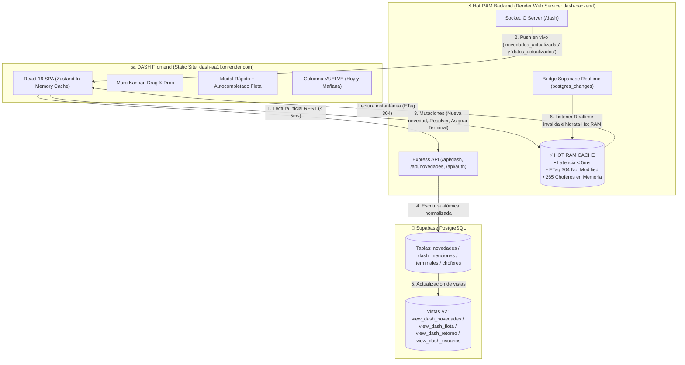

# DASH — Tablero Operativo de Flota (Monorepo React 19 + Node.js Hot RAM)

Aplicación integral de alto rendimiento para el seguimiento operativo de flota, cartelera Kanban interactiva, unidades libres, retornos de choferes en tiempo real y gestión de novedades.

- **Frontend (Static Site):** React 19, Vite, TypeScript, Tailwind CSS v4, Motion, DnD-Kit, Zustand.
- **Backend (Web Service - Hot RAM Engine):** Node.js Express, Socket.IO (`/dash`), compresión Gzip, ETag 304, dirty checking inteligente y bridge Supabase Realtime para supresión total de egress redundante.
- **Base de Datos:** Supabase PostgreSQL (`rsvajuxihvmpmrmlcbul`).

---

## 🏗️ Arquitectura y Flujo de Datos



---

## 📁 Estructura del Repositorio (Monorepo Canónico)

```text
dash/
├── backend/                              # ⚡ Web Service Node.js (Hot RAM + Express)
│   ├── routes/
│   │   ├── auth.js                       # Autenticación segura de operadores (/api/auth/login)
│   │   ├── dash.js                       # Endpoints Hot RAM (/api/dash/flota, /retorno, /novedades, /usuarios, /terminales)
│   │   └── novedades.js                  # Mutaciones atómicas (/api/novedades/actualizar, /mencion, /terminal)
│   ├── utils/
│   │   ├── normalizar.js                 # Normalización de textos y matching de choferes
│   │   └── supabase.js                   # Cliente Supabase, sanitización de fechas y puente Realtime
│   ├── server.js                         # Servidor Express, Socket.IO /dash, compresión gzip, auto-hidratación
│   ├── package.json                      # Dependencias backend aisladas
│   ├── .env.example                      # Variables de entorno modelo
│   └── .env                              # Configuración local (puerto 3005)
│
├── frontend/                             # 💻 Static Site React 19 SPA (Vite)
│   ├── src/
│   │   ├── components/
│   │   │   ├── kanban/                   # KanbanBoard, NoveltyCard, ReturnColumn, LibresRow, QuickAddLibre
│   │   │   ├── layout/                   # Header (Reloj 24h, 4 Vistas, Switch Cartelera), AuthDropdown, FAB
│   │   │   └── modals/                   # NoveltyModal (2 pasos con validación y autocompletado)
│   │   ├── hooks/                        # useDash (Socket.IO + REST), useAutoScroll (Modo Cartelera TV)
│   │   ├── services/                     # api.ts (cliente HTTP tolerante a fallos)
│   │   ├── store/                        # useDashStore.ts (Zustand con persistencia)
│   │   ├── types/                        # dash.ts (interfaces TypeScript)
│   │   ├── App.tsx                       # Orquestador visual 100% pantalla
│   │   ├── index.css                     # Tailwind CSS v4
│   │   └── main.tsx                      # Punto de entrada
│   ├── index.html                        # Plantilla HTML5
│   ├── package.json                      # Dependencias frontend aisladas
│   ├── tsconfig.json                     # Configuración TypeScript
│   ├── vite.config.ts                    # Configuración Vite
│   └── .env.example                      # Variables de entorno modelo (puerto 3005 / Render)
│
├── supabase/
│   └── dash_views_v2.sql                 # 🗄️ Script DDL oficial para migrar y actualizar las vistas en Supabase
│
├── render.yaml                           # 🚀 Blueprint oficial para desplegar ambos servicios en Render
├── package.json                          # Scripts de orquestación raíz
├── iniciar-dash.bat                      # Script de arranque rápido simultáneo en Windows
└── .gitignore                            # Exclusiones Git (node_modules, dist, .env)
```

---

## 🚀 Despliegue en Render (Web Service via Blueprint + Static Site Preexistente)

La arquitectura en producción se divide en:

1. **Frontend (Static Site Preexistente):**
   - URL de producción: [`https://dash-aa1f.onrender.com`](https://dash-aa1f.onrender.com)
   - ID del servicio: `srv-d9d6idn41pts73dn4p50`
   - Build Command: `npm install && npm run build` (Directorio raíz: `frontend`)
   - Publish Directory: `dist`
   - Rutas SPA: Rewrite automático `/*` ➔ `/index.html`

2. **Backend (Web Service vía Blueprint):**
   - Aprovisionado automáticamente mediante [`render.yaml`](render.yaml).
   - En el panel de Render, ir a **Blueprints > New Blueprint Instance** y conectar `matiENA/DASH`.
   - Servicio aprovisionado:
     - **`dash-backend` (Web Service):**
       - Directorio raíz: `backend`
       - Build Command: `npm install`
       - Start Command: `npm start`
       - Health Check: `/health` (Zero-downtime deploys)

---

## 🗄️ Vistas y Esquema de Supabase (Editor SQL)

El script SQL unificado [`supabase/dash_views_v2.sql`](supabase/dash_views_v2.sql) reemplaza las vistas legacy obsoletas por el esquema canónico v2:

- **`view_dash_novedades`**: Integra choferes, unidades, tractores, semis, cisternado, vencimientos operativos, catálogo de terminales y agregación relacional de menciones (`dash_menciones`).
- **`view_dash_flota`**: Catálogo maestro de 265 choferes con vencimientos (`MAS`, `VTV`, `Esp-Es`, `VI`, `VE`), fotos, teléfonos y servicios.
- **`view_dash_retorno`**: Choferes que retornan hoy y mañana calculados con estados de ayer, hoy y mañana para alimentar la columna `VUELVE`.
- **`view_dash_usuarios`**: Lista segura de operadores para autocompletar menciones (eliminando la exposición de passwords).
- **`view_dash_terminales`**: Catálogo oficial de terminales activas (`DOCK SUD`, `CAMPANA`, `ZARATE`, etc.).

---

## 💻 Desarrollo Local en Windows

Para ejecutar el entorno completo en Windows:

1. Doble clic en `iniciar-dash.bat` (o desde la consola):
   ```cmd
   iniciar-dash.bat
   ```
2. El script iniciará:
   - **Backend Hot RAM:** en `http://localhost:3005`
   - **Frontend React:** en `http://localhost:3000`
3. Se abrirá automáticamente el navegador en `http://localhost:3000`.
