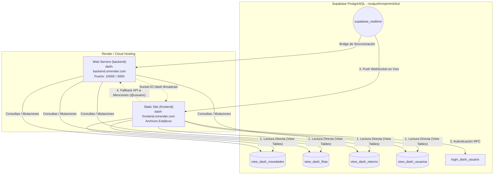

# DASH — Arquitectura Desacoplada (Backend Web Service + Frontend Static Site)

Este proyecto desacopla el tablero de operaciones **DASH** en dos componentes independientes listos para despliegue en la nube:

1. **`backend/`** ➔ **Web Service** (Node.js, Express, Socket.IO, Supabase, CORS, Gzip).
2. **`frontend/`** ➔ **Static Site** (HTML5, Tailwind, JavaScript Modular, Supabase Client Realtime).

---

## 🏗️ Diagrama de Arquitectura y Conexiones



---

## 📁 Estructura del Repositorio

```text
dash/
├── backend/                  # Web Service (API + Socket.IO)
│   ├── routes/
│   │   ├── auth.js           # /api/auth/login
│   │   ├── dash.js           # /api/dash/flota, retorno, novedades, usuarios
│   │   └── novedades.js      # /api/novedades/actualizar, mencion, terminal
│   │   utils/
│   │   ├── normalizar.js     # Sanitización de strings y patentes
│   │   └── supabase.js       # Cliente Supabase + Listener Realtime
│   ├── .env.example          # Plantilla de variables de entorno
│   ├── package.json          # Dependencias y scripts del Web Service
│   └── server.js             # Punto de entrada Express y Socket.IO
│
├── frontend/                 # Static Site (Cartelera e Interfaz)
│   ├── css/
│   │   └── styles.css        # Estilos, temas oscuro/claro, animaciones
│   ├── js/
│   │   ├── auth.js           # Lógica de login e inicio de sesión
│   │   ├── config.js         # Detección dinámica de entorno y API_URL
│   │   ├── feed.js           # Renderizado del Kanban, tarjetas, drag&drop
│   │   ├── modal.js          # Modal de nueva novedad y barra rápida
│   │   ├── socket.js         # Suscripción híbrida Supabase + Socket.IO
│   │   └── supabase-client.js# Cliente oficial @supabase/supabase-js
│   ├── index.html            # Aplicación de cartelera interactiva
│   └── card-libres.svg       # Recursos visuales
│
├── render.yaml               # Blueprint oficial para despliegue simultáneo en Render
├── iniciar-dash.bat          # Script de arranque rápido local en Windows
└── .gitignore                # Reglas de exclusión para Git
```

---

## 🚀 Despliegue en Render

El repositorio cuenta con un archivo [`render.yaml`](render.yaml) configurado como **Blueprint Monorepo**:

### Opción A: Despliegue con Blueprint (1-Click)
1. En el panel de Render, ir a **Blueprints**.
2. Conectar el repositorio de GitHub (`matiENA/DASH`).
3. Render detectará automáticamente `render.yaml` y creará ambos servicios:
   - **`dash-backend`** (Web Service).
   - **`dash-frontend`** (Static Site).

### Opción B: Configuración Manual en Render
Si prefieres crearlos individualmente desde el Dashboard:

#### 1. Backend (Web Service):
* **Environment:** `Node`
* **Root Directory:** `backend`
* **Build Command:** `npm install`
* **Start Command:** `npm start`
* **Health Check Path:** `/health`
* **Variables de Entorno:**
  * `PORT` = `10000`
  * `SUPABASE_URL` = `https://rsvajuxihvmpmrmlcbul.supabase.co`
  * `SUPABASE_KEY` = `sb_publishable_n97mVkSclRpuv_OsseO3gg_BjR9QT3R`
  * `FRONTEND_URL` = `https://<tu-frontend-name>.onrender.com`
  * `NODE_ENV` = `production`

#### 2. Frontend (Static Site):
* **Root Directory:** `frontend`
* **Build Command:** *(dejar vacío)*
* **Publish Directory:** `.`
* **Rewrite Rule:** `/*` ➔ `/index.html`

---

## 💻 Ejecución en Entorno de Prueba Local

Se han asignado los puertos estándar del ecosistema:
* **Frontend Static Site:** `http://localhost:3000`
* **Backend Web Service:** `http://localhost:3005`

### Opción 1: Arranque Rápido con Batch (Recomendado)
Simplemente ejecuta con doble clic el archivo [`iniciar-dash.bat`](iniciar-dash.bat).
Este script:
1. Inicia el Web Service en una consola en el puerto **3005**.
2. Inicia el servidor estático del frontend en otra consola en el puerto **3000**.
3. Abre automáticamente `http://localhost:3000` en tu navegador.

### Opción 2: Arranque Manual por Terminal

1. **Iniciar el Backend Web Service:**
   ```bash
   cd backend
   npm start
   # Activo en http://localhost:3005 (Health check: http://localhost:3005/health)
   ```

2. **Iniciar el Frontend Static Site:**
   ```bash
   cd frontend
   npm start
   # Activo en http://localhost:3000
   ```

