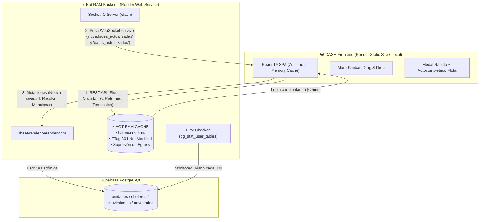

# DASH — Tablero Operativo de Flota (React 19 + Vite Static Site)

Aplicación frontend de alto rendimiento para el seguimiento operativo de flota, cartelera Kanban interactiva, unidades libres y novedades en tiempo real. 

- **Frontend:** React 19, Vite, TypeScript, Tailwind CSS v4, Motion, DnD-Kit, Zustand.
- **Backend Embebido (Hot RAM Engine):** Conectado al Web Service de alta reactividad [`sheet-render`](https://sheet-render.onrender.com) con Dirty Check inteligente contra Supabase PostgreSQL, ETag 304 y canales WebSocket `/dash` en tiempo real.

---

## 🏗️ Arquitectura y Flujo de Datos



---

## 📁 Estructura del Repositorio

```text
dash/
├── src/
│   ├── components/           # Componentes modulares de interfaz
│   │   ├── kanban/           # KanbanBoard, NoveltyCard, ReturnColumn, LibresRow
│   │   ├── layout/           # Header, AuthDropdown, FloatingActionButton
│   │   └── modals/           # NoveltyModal (creación y edición con autocompletado)
│   ├── hooks/                # useDash (conexión API + Socket.IO en vivo), useAutoScroll
│   ├── services/             # api.ts (cliente HTTP para Hot RAM Backend)
│   ├── store/                # useDashStore.ts (estado global con Zustand)
│   ├── types/                # dash.ts (interfaces canónicas TypeScript)
│   ├── App.tsx               # Orquestador principal de la vista
│   ├── index.css             # Directivas Tailwind CSS
│   └── main.tsx              # Punto de entrada de React
│
├── render.yaml               # Blueprint oficial para despliegue Static Site en Render
├── vite.config.ts            # Configuración de compilación Vite + plugins
├── tsconfig.json             # Configuración de TypeScript
├── package.json              # Dependencias y scripts
├── iniciar-dash-react.bat    # Script de arranque rápido local en Windows
└── .gitignore                # Reglas de exclusión para Git
```

---

## 🚀 Despliegue en Render (Static Site)

El repositorio incluye el archivo [`render.yaml`](render.yaml) configurado para despliegue instantáneo como **Static Site**:

1. En el panel de Render, ir a **Blueprints > New Blueprint Instance**.
2. Conectar el repositorio de GitHub (`matiENA/DASH`).
3. Render detectará automáticamente `render.yaml` y configurará el servicio:
   - **Nombre:** `dash-frontend`
   - **Build Command:** `npm install && npm run build`
   - **Publish Directory:** `dist`
   - **Rutas SPA:** Rewrite automático `/*` ➔ `/index.html`.
4. El frontend conectará de forma transparente con el backend Hot RAM (`https://sheet-render.onrender.com`).

---

## 💻 Desarrollo Local

Para ejecutar el entorno local en Windows:

1. Doble clic en `iniciar-dash-react.bat` (o por terminal):
   ```bash
   npm install
   npm run dev
   ```
2. La aplicación abrirá automáticamente en: `http://localhost:3000` (o `http://localhost:5173`).
3. Si el backend local (`dash-backend`) está corriendo en el puerto `3005`, se conectará a este; de lo contrario, utilizará el servicio Hot RAM en la nube.
